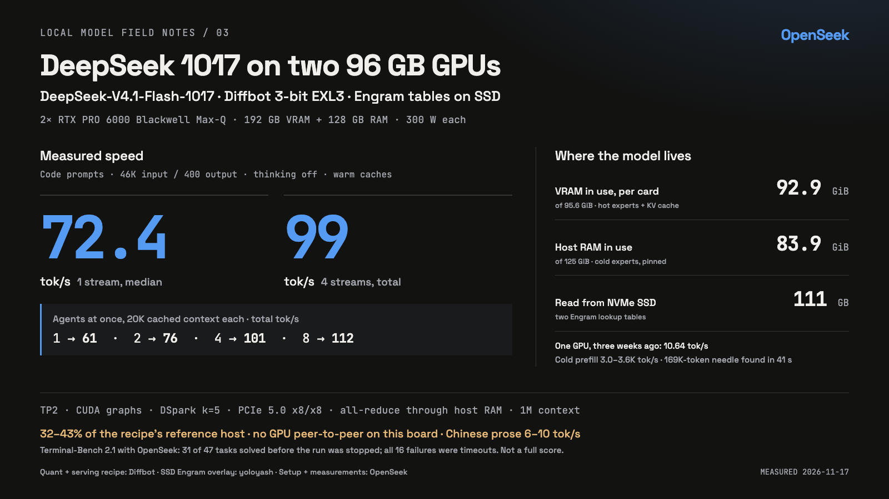

# DeepSeek-V4.1-Flash-1017 on two RTX PRO 6000 and 128 GB of RAM

Measured **2026-11-17** on two RTX PRO 6000 Blackwell **Max-Q 96 GB / 300 W** cards, a Core Ultra 9 285K, 128 GB of
host RAM and local NVMe: **72 tok/s on one stream and about 99 tok/s across four** on code prompts, with CUDA graphs,
DSpark speculative decoding, vision and the 1M-token window. The same host with one card measured
[10.64 tok/s](deepseek-v41-flash-1017.md).



[Download the 1600×900 card](assets/deepseek-1017-dual-gpu-card.png) ·
[Editable HTML source](assets/deepseek-1017-dual-gpu-card.html) ·
[All measurements](../results/2026-11-17-deepseek-3bpw-dual-gpu/SUMMARY.md) ·
[Launcher and probes](../experiments/deepseek-v41-flash-1017-dual-gpu/)

This is a manual experiment, separate from the qualified Qwen recipe in `./recipe`. It adds no engine code: it
runs [Diffbot's 3-bit pack](https://huggingface.co/diffbot/DeepSeek-V4.1-Flash-EXL3-3bpw-2x-RTX-PRO-6000) through
[yoloyash's SSD-Engram overlay](https://github.com/yoloyash/dsv41-flash-1017-2x-rtx-pro-6000-ssd-engram) with the
settings a consumer board needs.

## Where the model lives

| Location | Amount | What lives there |
|---|---:|---|
| GPU memory | **92.9 GiB of 95.6 GiB** on each card | The experts used most often, the other layers, KV cache, compute workspace, and a 512-slot cache holding copies of RAM experts |
| Host RAM | **about 84 GiB** of a 108 GiB container cap | The less-used experts, pinned; the GPUs read them over PCIe when a token routes to one |
| NVMe SSD | **111 GB** | The two Engram lookup tables. Rows for each step are read before the GPU step runs, so the CUDA graphs still work |

Diffbot's own recipe pins the Engram tables in RAM and needs about 230 GiB. The overlay is what makes 128 GB enough.

## What it is good for

| Workload | Measured |
|---|---|
| Code, one stream | 44–72 tok/s, first token in under a second |
| A second question on a 51.5K-token code prompt | first token in 1.4 s (14.3 s the first time) |
| Four agents at once | about 100 tok/s in total, 25 each; more agents add almost nothing |
| Hard problems with thinking on | solved an interval tree in 173 s using 9,878 reasoning tokens; leave room in `max_tokens` |
| Chinese prose | **6–10 tok/s**. The expert placement is tuned for coding agents |

## Reproduce

Needs two 96 GB RTX PRO 6000 cards (sm_120) with nothing else on them, NVIDIA driver with CUDA ≥ 13, Docker with the
NVIDIA runtime, about 125 GiB of usable RAM, and 400 GB of NVMe (315 GB pack, 35 GB image).

```bash
# 1. Diffbot's pack, pinned. hf download drops the executable bit on the recipe scripts.
hf download diffbot/DeepSeek-V4.1-Flash-EXL3-3bpw-2x-RTX-PRO-6000 \
  --revision 6110453b901e4b51da66f539f3802b5c7f18e8e8 --exclude "drafter-code-fp8/*" --local-dir ~/models/dsv41-1017-3bpw
find ~/models/dsv41-1017-3bpw/recipe -name "*.sh" -exec chmod +x {} +

# 2. Diffbot's image and kernels. Skip cpuexp/build.sh: it needs AVX-512.
(cd ~/models/dsv41-1017-3bpw/recipe && ./docker/build.sh && ./kernels/build.sh)

# 3. The overlay, pinned
git clone https://github.com/yoloyash/dsv41-flash-1017-2x-rtx-pro-6000-ssd-engram ~/src/ssd-engram
git -C ~/src/ssd-engram checkout ca6491e

# 4. Both cards visible inside Docker? Expect two lines.
docker run --rm --gpus all --entrypoint nvidia-smi dsv41-flash-1017-exl3-3bpw-sm120 -L

# 5. Byte-check mode once, then serve
cd experiments/deepseek-v41-flash-1017-dual-gpu
export API_KEY=change-me PACK=~/models/dsv41-1017-3bpw OVERLAY=~/src/ssd-engram
./serve.sh parity      # send a few requests (python3 smoke.py); it raises on any Engram mismatch
./serve.sh             # ready at "[warmup] done", about 5 minutes
```

The model id is `deepseek-v4.1-flash` on port 8001. Clients must send the API key.

## Four things that went wrong here

1. **Docker saw one card.** `/etc/cdi/nvidia.yaml` had been generated when the host had a single GPU. vLLM stops with
   `World size (2) is larger than the number of available GPUs (1)`. Fix:
   `sudo nvidia-ctk cdi generate --output=/etc/cdi/nvidia.yaml`.
2. **`./docker/build.sh: Permission denied`.** `hf download` does not keep executable bits (step 1 above).
3. **No GPU peer-to-peer.** `nvidia-smi topo -p2p r` reports `CNS` (chipset not supported) between the cards on this
   Z890 board. With `DS41_CAR=1 DS41_CAR_PCIE_IPC=1` the engine dies at start with
   `CUDART error: peer access is not supported between these two devices`. `serve.sh` therefore turns off the 8-bit
   prefill all-reduce and the in-graph custom all-reduce, and all-reduces go through NCCL over host memory.
4. **A second card that the system does not list.** After installing it, the first card dropped to x8 but only one
   GPU appeared in `lspci`. The new card's 16-pin power connector was not fully seated.

IOMMU in `Translated` mode did not block start-up on this host.

## Why it is slower than the overlay's reference host

The reference host (600 W cards, PCIe 4.0 x16 with peer-to-peer, 8 memory channels) reports 163–169 tok/s on one
stream, 299–316 across four, and 7,263–7,457 tok/s fresh prefill. This host reaches 32–43% of that. Known differences:
no peer-to-peer, PCIe x8 per card, two memory channels at 4800 MT/s, 300 W cards, a 512-slot instead of a 736-slot
host-expert cache. Which of these costs the most was not isolated. Not yet tried: XMP memory timings and
`HOST_CACHE=736` with nothing else on the cards.

## Using it from OpenSeek

OpenSeek needs the model id and the key; the base URL stays whatever points at port 8001.

```bash
OPENSEEK_MODEL=deepseek-v4.1-flash OPENSEEK_API_KEY=change-me openseek
```

DeepSeek takes both cards, so it cannot run next to the Qwen recipe.

## Credits and licenses

Quantization, vLLM image, kernels and serving recipe: [Diffbot](https://huggingface.co/diffbot/DeepSeek-V4.1-Flash-EXL3-3bpw-2x-RTX-PRO-6000)
(weights MIT; the image includes an AGPL-3.0 `vllm-exl3` patch, see the pack's `recipe/THIRD_PARTY_NOTICES.md`).
Engram-on-SSD overlay: [yoloyash](https://github.com/yoloyash/dsv41-flash-1017-2x-rtx-pro-6000-ssd-engram)
(MIT + Apache-2.0). The launcher and probes in this repository are MIT.
