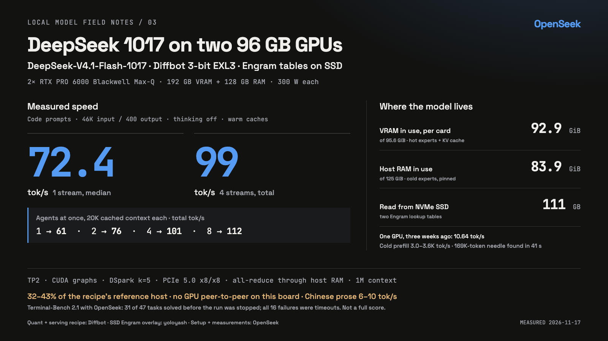

# DeepSeek 1017 3-bit on two GPUs — 2026-11-17

Two RTX PRO 6000 Blackwell Max-Q (96 GB, 300 W each, PCIe 5.0 x8/x8, no GPU peer-to-peer), Core Ultra 9 285K,
128 GB DDR5 at 4800 MT/s, local NVMe. Diffbot 3-bit EXL3 pack @ `6110453b`, yoloyash SSD-Engram overlay @ `ca6491e`,
TP2, CUDA graphs, DSpark k=5, vision on, 1M context, `HOST_CACHE=512`, `CONTAINER_MEM=108g`, NCCL all-reduce through
host memory. [Reproduction](../../docs/deepseek-v41-flash-1017-dual-gpu.md) · hardware in [`gpu.txt`](gpu.txt).

## Decode and prefill

Diffbot's `bench/bench-fixed.py` (code corpus, temperature 0, thinking off). Run 1 started on cold caches.

| | Run 1 | Run 2 | Run 3 | Overlay's reference host |
|---|---:|---:|---:|---:|
| 1 stream, 2K prompt, tok/s | 38.8 | 63.8 | 66.6 | 162.7–163.3 |
| 1 stream, 46K prompt, median tok/s | 65.3 | 72.6 | 72.4 | 165.9–168.7 |
| per-request range at 46K | 33.6–84.1 | 59.6–85.4 | 62.0–89.2 | |
| 4 streams, 46K, total tok/s | 99.3 | 98.9 | 98.6 | 298.7–315.9 |
| Fresh prefill, ~40K tokens, tok/s | 3,003 / 3,646 | prefix-cached | prefix-cached | 7,263–7,457 |

The reference host has 600 W cards on PCIe 4.0 x16 with peer-to-peer and 8 memory channels; its numbers are from the
overlay's README. While decoding one stream here, each card drew 115–170 W of 300 W, the host-expert cache served
81–82% of cold routes from VRAM, and DSpark accepted 2.85–3.07 tokens per round.

## By workload

`bench/practical.py`, streamed, decode = completion tokens / time after the first token.

| Case | Prompt tokens | Output tokens | TTFT s | Decode tok/s |
|---|---:|---:|---:|---:|
| English code | 34 | 900 | 0.70 | 47.6 |
| JSON array | 34 | 1,181 | 0.59 | 19.4 |
| Reasoning puzzle, thinking on | 88 | 1,113 | 1.46 | 22.3 |
| Chinese prose | 24 | 278 | 0.99 | 6.1 |
| 51.5K-token code prompt, cold | 51,517 | 400 | 14.34 | 35.5 |
| Same prompt again, prefix-cached | 51,517 | 400 | 1.41 | 48.6 |

`bench/prose_probe.py`, six prose requests in a row: Chinese 6.0 / 7.0 / 9.3 / 5.7 / 9.6 tok/s, English 16.7 tok/s.
The host-expert plan (`plan-1017-agent30-c512-p375`) is tuned for agentic coding; prose did not speed up with use.

## Concurrency

`bench/concurrency.py`: each stream has its own ~20K-token code context already in the prefix cache and writes 400 tokens.

| Streams | Total tok/s | Per stream tok/s |
|---:|---:|---:|
| 1 | 61.1 | 61.1 |
| 2 | 76.4 | 38.2 |
| 3 | 84.0 | 28.0 |
| 4 | 101.1 | 25.3 |
| 6 | 99.1 | 16.5 |
| 8 | 112.0 | 14.0 |

## Checks verified by code

| Check | Result | Output tokens | Seconds |
|---|---|---:|---:|
| Regex matching, 11 tests | pass | 556 | 13.7 |
| Trapping rain water 2D, 5 tests | pass | 725 | 16.1 |
| Interval tree vs brute force, 3,000 random operations | pass with a 30,000-token cap (9,878 reasoning tokens); no answer with a 5,000 cap | 10,739 | 172.8 |
| 7^2025 mod 1000 | pass (807) | 429 | 14.8 |
| Length-8 strings over 3 letters, no equal neighbours, same first and last | pass (126) | 466 | 14.3 |
| P(product of three dice divisible by 6) | pass (133/216) | 472 | 10.8 |
| Needle in 169,504 tokens of code | found, TTFT 41.4 s | 101 | 44.1 |

Parity mode (`serve.sh parity`) raised no Engram mismatch over four smoke requests.

## Terminal-Bench 2.1 with OpenSeek, stopped early

Harbor 0.26.0, 89-task dataset `terminal-bench-2-1@sha256:7d7bdc1c…`, OpenSeek 0.0.11 as the agent (one-shot,
200 steps), 4 tasks at once, task timeouts ×2, one attempt per task. The run was stopped by hand after 6 h 55 min.

| | Count |
|---|---:|
| Trials finished (alphabetical: adaptive-rejection-sampler to merge-diff-arc-agi-task) | 47 |
| Resolved | 31 |
| Failed | 16, all `AgentTimeoutError` |
| Agent timeouts in total | 22 (6 still passed the verifier) |
| Cancelled in flight when stopped | 4 |
| Never started | 38 |

**This is not a Terminal-Bench score.** `raw/terminal-bench-summary.json` prints 31/89 because it divides by all
89 tasks. The official leaderboard requires five attempts per task.

## Memory

| | |
|---|---:|
| VRAM in use per card, sampled during benchmarks | 95,102 MiB = 92.9 GiB of 95.6 GiB |
| Serving container | 83.5–83.9 GiB of a 108 GiB cap |
| Engram tables read from NVMe | 110.9 GB (shards 47 and 48) |
| Checkpoint on disk | 315 GB |

## Not measured

Quality benchmarks (GSM8K, HumanEval, KL), a full Terminal-Bench run, any comparison with Qwen3.8 on the same tasks,
XMP memory timings, `HOST_CACHE=736`, and a board with GPU peer-to-peer.

`raw/`: the three `bench-fixed` output lines, `practical.json`, `conc.log`, and the Terminal-Bench summary and run
metadata (task names, pass/fail, timings and token counts only; no task content or trajectories).
